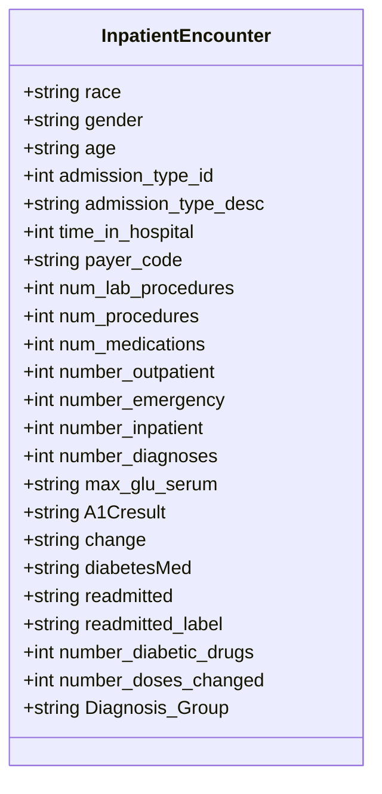

# Clinical Diabetes Inpatient Analytics Dashboard

A healthcare data analysis and decision-support web application for the **"Diabetes 130-US Hospitals"** dataset (`cleaned_diabetic_data.csv`), analyzing **101,745 inpatient encounters** across 130 medical centers from 1999 to 2008.

This project investigates inpatient diabetes care patterns, therapeutic changes, and hospital bounce-back determinants, building upon the clinical research published by **Strack et al. (2014)** (*"Impact of HbA1c Measurement on Hospital Readmission Rates: Analysis of 70,000 Clinical Database Patient Records"*).

---

## 1. System Architecture & Features

The dashboard is built with a cohesive medical design system adhering to healthcare reporting standards:

- **Light Theme Enforced**: Explicitly configured in `.streamlit/config.toml` (`base = "light"`).
- **Curated Medical Palette**:
  - Primary Clinical Blue: `#1F6FB2`
  - Dark Navy for Headings: `#0F2D59`
  - Crisp Content Backgrounds: `#FFFFFF`
  - Soft Card Shadows: `rgba(15, 45, 89, 0.04)`
  - Status Indicators: `#10B981` (Normal/Low Risk), `#F59E0B` (Moderate Warning), `#DC2626` (Early Readmission Alert).
- **Clean Typography**: Inter (body) and Poppins (headings) via Google Fonts.
- **Side-by-Side Chart & Key Review Layout**: Every chart is paired alongside an executive "Key Review" card:
  1. Standardized page header with clinical category tag and subtitle
  2. Four top-line KPI cards with blue accent border and icons
  3. Side-by-side layout (`[7, 5]` column ratio): Chart on the left with clean numbers (`text_auto=True`) and an executive "Key Review" panel on the right explaining the findings in plain, non-technical language.
- **Interpretability First**: Strictly uses accessible charts (bar charts, horizontal bars, donut charts, line charts, histograms, heatmaps) without hard-to-read box plots or violin plots.


---

## 2. Analytical Pages

| Page | Scope & Key Findings |
| :--- | :--- |
| **Executive Overview** | Population summary, 46.1% overall readmission rate, 11.2% early (<30d) readmissions, 4.40-day average length of stay, and circulatory diagnosis preponderance. |
| **Demographics & Admission** | Age deciles (peak volume in 70–80 cohort), outcome parity across gender (53.8% female vs 46.2% male, identical ~11.1% early readmit rate), racial distribution, and emergency admission stay duration. |
| **Glycemic & Lab Testing** | Evaluation of inpatient HbA1c testing (only 16.7% tested) vs early readmission risk (<10% readmission when tested vs 11.4% when untested), comorbidity escalation, and lab volume. |
| **Medication Regimens** | Antidiabetic drug prescribing (77.0%), active dosage titrations (46.2%), polypharmacy escalation (up to 4 agents), and length-of-stay impact. |
| **Readmission Risk Drivers** | Prior inpatient admissions as the strongest predictor (2.5x higher bounce-back rate for 2+ visits), 2D heatmap cross-tabulating prior ER and inpatient admissions (up to 34% readmission), and length of stay correlation. |
| **Dataset Explorer** | Live sub-cohort filtering, search, numerical percentile statistics, and sample CSV export for audit and reproducibility. |

---

## 3. Database Schema & Feature Pipeline



### Preprocessing & Data Hygiene
- **Gender Handling**: Visualizations exploring gender filter out the 3 unclassified records (`Unknown/Invalid`), analyzing 101,742 valid demographic encounters.
- **Diagnosis Grouping**: High-cardinality ICD-9 codes are mapped into 7 primary diagnostic categories: *Circulatory, Respiratory, Digestive, Diabetes, Injury, Genitourinary, and Other*.
- **Drug Aggregation**: 23 individual generic drug columns are summarized into two engineered indicators: `number_diabetic_drugs` (total active agents) and `number_doses_changed` (dosage titrations).
- **Caching**: Data loading is wrapped with `@st.cache_data` for instantaneous page transitions.

---

## 4. Setup and Execution

### Environment Prerequisites
Activate your Conda environment named **`external`**:

```bash
conda activate external
```

### Installed Dependencies
The environment includes:
- `streamlit==1.44.1`
- `plotly==6.9.0`
- `pandas==2.3.3`
- `numpy==2.5.1`
- `streamlit-option-menu==0.4.0` *(Installed for professional sidebar navigation)*

### Running the Application

From the project root directory, launch the app using:

```bash
streamlit run app.py
```

The application will open in your default browser at `http://localhost:8501`.
