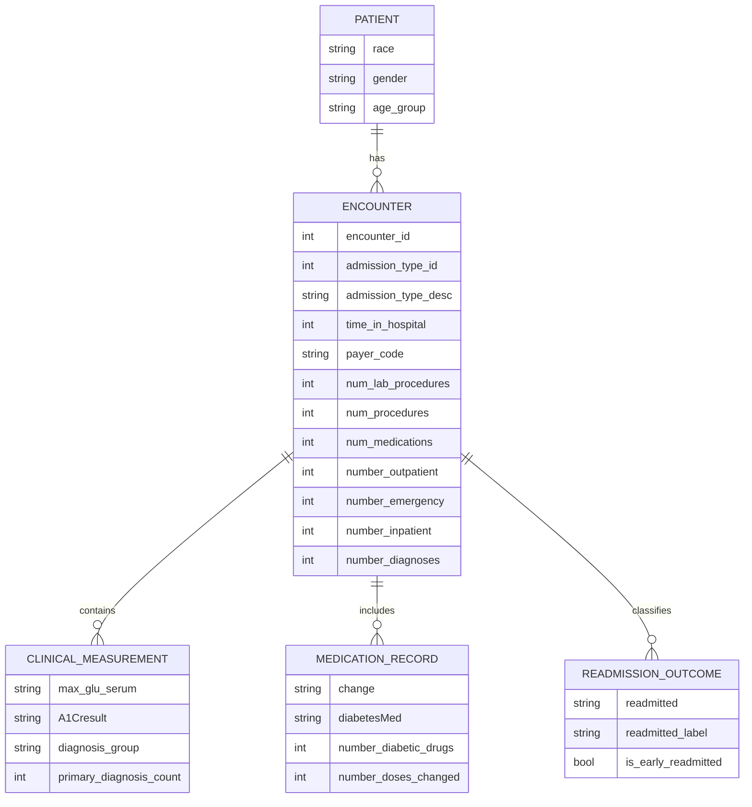

# Clinical Diabetes Analytics Dashboard

## Project Credit

This project was developed by Dr. Mohamed Ismael.

LinkedIn: https://www.linkedin.com/in/mohamedismael22/

This project is a clinical analytics dashboard built for exploring inpatient diabetes outcomes using the Diabetes 130-US Hospitals dataset. It is designed to help healthcare analysts and stakeholders understand treatment patterns, hospital utilization, readmission risk, and care quality indicators from a large inpatient dataset.

The application analyzes hospital encounters and highlights operational insights such as patient demographics, lab testing practices, medication regimens, and the clinical drivers of readmission risk. The analysis is packaged as a Streamlit dashboard that makes large healthcare datasets easier to interpret through interactive visual reporting.

## Project Overview

The dashboard focuses on the following questions:

- Which patient groups are most represented in the dataset?
- Do demographic and admission characteristics influence readmission patterns?
- How often are HbA1c and glucose tests performed?
- Which medication patterns are associated with longer hospital stays or greater risk?
- What combinations of prior admissions and clinical variables are linked to early readmission?

This project supports clinical review and operational analysis using data from 130 hospitals and covers a large inpatient population from 1999 to 2008.

## Key Features

- Executive overview with summary KPIs and readmission trends
- Demographics and admission analysis by age, gender, race, and care setting
- Clinical lab and glycemic testing review
- Medication regimen and treatment-change monitoring
- Readmission risk driver analysis
- Interactive dataset explorer for filtered cohort review
- Clean, healthcare-oriented dashboard styling suitable for reporting

## Data Model and Schema

The dataset is structured as a flat clinical encounter table with one row per inpatient encounter. The schema is conceptually organized around patient demographics, admission details, clinical measurements, treatment changes, and outcomes.



### Core Dataset Fields

The cleaned dataset contains the main clinical variables used throughout the dashboard:

| Category | Representative Fields |
| --- | --- |
| Patient Demographics | `race`, `gender`, `age` |
| Admission Context | `admission_type_id`, `admission_type_desc`, `time_in_hospital`, `payer_code` |
| Clinical Complexity | `number_diagnoses`, `num_lab_procedures`, `num_procedures`, `num_medications` |
| Prior Utilization | `number_outpatient`, `number_emergency`, `number_inpatient` |
| Lab and Glycemic Data | `max_glu_serum`, `A1Cresult` |
| Medication Treatment | `change`, `diabetesMed`, `number_diabetic_drugs`, `number_doses_changed` |
| Outcome | `readmitted`, `readmitted_label`, `is_early_readmitted` |

### Data Processing Notes

- Categorical diagnosis codes are grouped into clinically meaningful categories for reporting.
- Medication variables are summarized into engineered indicators to simplify analysis.
- Gender filtering excludes unclassified records to maintain valid comparisons.
- Admission and readmission labels are converted into human-readable reporting values.

## Project Structure

```text
Clinical Diabetes Analytics/
├── app.py
├── README.md
├── cleaned_diabetic_data.csv
├── requirements.txt
├── assets/
├── components/
├── pages/
├── views/
├── .gitignore
└── .streamlit/
```

## Setup and Run

### 1. Create and activate your own virtual environment

On Windows PowerShell:

```powershell
python -m venv .venv
.\.venv\Scripts\Activate.ps1
```

If you are using Command Prompt:

```cmd
python -m venv .venv
.venv\Scripts\activate.bat
```

### 2. Install dependencies

```bash
pip install -r requirements.txt
```

### 3. Launch the dashboard

From the project root directory:

```bash
streamlit run app.py
```

The application will open in the default browser at:

```text
http://localhost:8501
```

## Dashboard Pages

- Executive Overview
- Demographics & Admission
- Glycemic & Lab Testing
- Medication Regimens
- Readmission Risk Drivers
- Dataset Explorer

## Technologies Used

- Python
- Streamlit
- Pandas
- NumPy
- Plotly
- Streamlit Option Menu

## Notes

This application is intended for analytical exploration and decision support rather than direct clinical diagnosis. It is best used to identify patterns, risk signals, and operational questions that can inform further investigation by clinicians and healthcare analysts.
